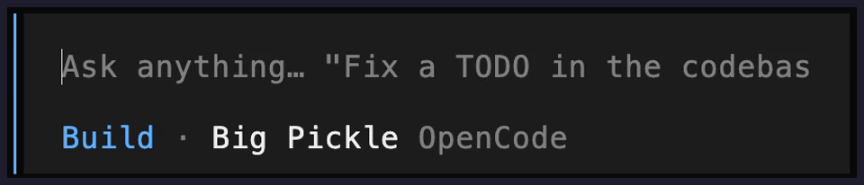

<h1 align="center">
  <picture>
    <source media="(prefers-color-scheme: dark)" srcset="assets/logo-dark.svg">
    
  </picture>
</h1>

<p align="center">
  <a href="https://github.com/ozandogrultan/opencode-quill/actions/workflows/ci.yml"></a>
  <a href="https://www.npmjs.com/package/opencode-quill"></a>
  <a href="LICENSE"></a>
  <a href="#contributing"></a>
  <a href="https://github.com/ozandogrultan/opencode-quill/stargazers"></a>
</p>

Local word autocomplete and next-word prediction for the **OpenCode V2** prompt
composer — inspired by [oh-my-pi (OMP)](https://github.com/can1357/oh-my-pi)'s
n-gram text prediction engine.

As you type, Quill predicts the remainder of your current prose word or the next
word in sequence, shown as dimmed inline ghost text directly at your cursor.
Press <kbd>Tab</kbd> or <kbd>→</kbd> to accept it, or <kbd>Esc</kbd> to dismiss.

<p align="center">
  
</p>

**Install:** add `"opencode-quill"` to `plugins` in `~/.config/opencode/cli.json`
and restart OpenCode ([details](#install)).

## What it does

- **Zero AI, completely local:** Runs entirely on-device without sending prompt
  text to any model, API, or external service.
- **Context-aware ranking:** Blends a common-English vocabulary prior with an
  online n-gram model (bigrams and trigrams) learned from your prompt history.
- **Completes words, fixes typos, and predicts next words:** Completes the active
  prose prefix, offers single-edit corrections, and predicts following words
  when learned evidence supports the sequence.
- **Ghost-text styling:** Matches [opencode-ghost](https://github.com/ozandogrultan/opencode-ghost)'s
  dimmed appearance (the theme's muted text color), rendered in the OpenTUI
  buffer without displacing the cursor.
- **Safe acceptance:** Inserts or corrects the active word in the draft without
  submitting. Supports native undo (<kbd>Ctrl+-</kbd> or <kbd>Cmd+Z</kbd>). Never
  overwrites unrelated draft text and never touches the system clipboard.
- **Coexists with Ghost:** [Ghost](https://github.com/ozandogrultan/opencode-ghost)
  suggests entire next prompts in an *empty* composer using a model; Quill
  predicts words in an *active* draft locally. When both are installed, each
  activates only in its respective domain without key conflicts.
- **Prose-aware gating:** Automatically suppresses suggestions in code blocks,
  backticks, file paths, URLs, slash commands, active selections, and modal
  dialogs. Hyphenated words (`read-only`), brand names (`OpenCode`, `GitHub`)
  and bare filenames with common extensions (`install.sh`) count as prose;
  identifiers (`showSidebar`), flags and `key=value` tokens do not.
- **Shell mode:** In the prompt's shell mode Quill completes commands,
  subcommands and flags from a separate vocabulary learned from the commands
  you ran, never from prose. Shell completion is case-sensitive, never corrects
  typos, and skips paths, quoted strings, `$` expansions, assignments and any
  command that mentions a token, secret, password, passphrase, key, cookie or
  credential, passes a password flag (`curl -u user:pass`, `mysql -p…`,
  `sshpass -p`, `docker login -p`), or contains a recognisable API token
  (`sk-`, `ghp_`, `glpat-`, `xoxb-`, JWT, AWS key ID). Attachment and pasted-text chips are treated as non-prose:
  words are still suggested after them, but never inside them, and typo
  replacements are not offered while a chip is present.
- **End-of-draft by default:** Suggestions appear on a partial word or after a
  space at the end of the draft. Opt-in logical-line-end completion can also
  append a suffix or next word immediately before a newline, preserving later
  lines. It never suggests in the middle of a line or at a visual wrap boundary.

## What suggestions look like

The suggestion appears dimmed at the cursor, at the end of the draft or an
opt-in logical line end. It is not part of the editable text until you press
<kbd>Tab</kbd> or <kbd>→</kbd>.

| Kind | Your draft | Dimmed suggestion | Draft after acceptance |
| --- | --- | --- | --- |
| Word completion | `please comp` | `lete` | `please complete` |
| Typo correction | `please cmplete` | ` → complete` | `please complete` |
| Next word | `please run ` | `tests` | `please run tests` |

A correction looks like this, with only ` → complete` dimmed:

```text
> please cmplete → complete
```

- **Completions append** the missing letters or next word.
- **Corrections replace only the active word**, preserving its initial-capital
  or all-uppercase casing (`Cmplete` → `Complete`, `CMPLETE` → `COMPLETE`).
  First-person contractions use a capital `I` in corrections and next-word
  suggestions (`I'm`, `I'll`, `I've`, `I'd`). Lowercase contraction prefixes
  are replaced on acceptance too (`i'v` → `I've`). Typing the apostrophe
  continues the word (`i'` offers `I'd`), and a word ending in an apostrophe
  is never typo-corrected (`users'` stays as typed).
- **Learned casing is kept.** A word you usually capitalize mid-sentence is
  suggested that way: `oz` shows ` → Ozan` and replaces the word, while `Oz`
  completes with `an`.
- **Normal completions take precedence.** For example, `whate` completes to
  `whatever` rather than being corrected to `what`. Typo correction is a
  fallback when no confident prefix completion is available; recognized words
  are not corrected.
- **Earlier words are never rewritten.** With learned evidence for
  `please run tests`, typing `please rnu ` can suggest `tests`. Accepting it
  produces `please rnu tests`, leaving `rnu` unchanged.

## Quill or Ghost?

|             | quill                                          | [ghost](https://github.com/ozandogrultan/opencode-ghost) |
| ----------- | ---------------------------------------------- | -------------------------------------------------------- |
| Suggests    | the rest of the current word, or the next word | your whole next prompt                                    |
| When        | while you type a draft                         | the composer is empty, after a turn                       |
| How         | a local n-gram model, no network               | a small model reads the recent conversation               |
| Model calls | none                                           | one per turn                                              |

Install both: each activates only in its own domain, with no key conflicts.

## Requirements

- [OpenCode](https://opencode.ai) with the V2 TUI plugin runtime (the supported
  range is `engines.opencode` in `package.json`).
- Node.js (for the installer script).

## Install

### From npm (recommended)

Add the package to `plugins` in `~/.config/opencode/cli.json`:

```jsonc
{
  "$schema": "https://opencode.ai/v2/cli.json",
  "plugins": [
    "opencode-quill"
  ]
}
```

OpenCode installs the package and its dependencies on the next start.

### From this repository

```sh
git clone https://github.com/ozandogrultan/opencode-quill.git
cd opencode-quill
bun install
./install.sh
```

Restart OpenCode to load it. `install.sh` copies the plugin and its local
vocabulary into `<config>/plugins/opencode-quill/` and registers that directory
in `<config>/cli.json`. Unrelated plugins and configuration are preserved.

To target a specific configuration directory:

```sh
./install.sh /path/to/config/opencode
```

### Manually

Add the plugin directory to `plugins` in `~/.config/opencode/cli.json`:

```jsonc
{
  "$schema": "https://opencode.ai/v2/cli.json",
  "plugins": [
    "/absolute/path/to/opencode-quill/src"
  ]
}
```

To pass custom options:

```jsonc
{
  "$schema": "https://opencode.ai/v2/cli.json",
  "plugins": [
    {
      "package": "/absolute/path/to/opencode-quill/src",
      "options": {
        "enabled": true,
        "completeAtLineEnd": true,
        "acceptKeys": ["tab", "right"],
        "dismissKeys": ["escape"]
      }
    }
  ]
}
```

Restart OpenCode after editing `cli.json`.

## Options

| Option | Type | Default | Description |
| --- | --- | --- | --- |
| `enabled` | `boolean` | `true` | Initial default for suggestions and learning; a persisted `/quill` toggle takes precedence. |
| `completeAtLineEnd` | `boolean` | `false` | Also append completions or next words immediately before a newline within a draft. |
| `completeShell` | `boolean` | `true` | Initial default for shell-mode suggestions and learning; a persisted `/quill shell` toggle takes precedence. |
| `minSuggestedWordLength` | `number` | `0` | Minimum number of characters in a suggested word, for both prose and shell suggestions; `0` allows any length. |
| `acceptKeys` | `string[]` | `["tab", "right"]` | Keys that accept and insert the active word suggestion. |
| `dismissKeys` | `string[]` | `["escape"]` | Keys that dismiss the visible suggestion without inserting. |
| `cycleNextKeys` | `string[]` | `[]` | Opt-in keys to select the next alternative and open the picker, for example `["alt+n"]`. |
| `cyclePreviousKeys` | `string[]` | `[]` | Opt-in keys to select the previous alternative and open the picker, for example `["alt+p"]`. |
| `summonKeys` | `string[]` | `[]` | Opt-in keys to open the picker or summon candidates on demand, for example `["ctrl+y"]`. |

`completeAtLineEnd` uses prose context only up to the cursor while checking
code and attachment ranges across the full draft. It inserts only missing
letters or a next word, without replacing typed text. Typo and casing
replacements remain limited to chip-free draft ends. The suggestion must fit
the visible cursor row; it never overwrites the next line. Acceptance preserves
later lines, attachment metadata, host callbacks, and native undo/redo.

Quill shows one inline suggestion by default. To open the alternatives picker
with Ctrl+Y, add this to the Quill plugin's `options`:

```json
{
  "summonKeys": ["ctrl+y"]
}
```

Press Ctrl+Y to see the available words in a box above the active word, or
above the top of the editor when the cursor is below its first row. The box
uses an opaque background even on transparent themes. If no
automatic suggestion appears, Ctrl+Y can summon lower-confidence candidates.
This matters most after a space: next-word predictions are shown automatically
only when one word is likely, but summoning lists the words you usually type
after the previous word, even when none of them is confident enough to show on
its own. While the list is visible, Up and Down move the highlight and the inline ghost previews the
selection. Tab accepts it, Escape closes the list, and editing the draft or
moving the cursor resets it. Enter keeps its usual behavior.

For direct cycling, optionally set `cycleNextKeys` to `["alt+n"]` and
`cyclePreviousKeys` to `["alt+p"]`. These open the picker and cycle immediately,
even without a summon key. If there isn't room above the word, the cycle keys
still work inline. With a summon key, pressing it again selects the next
alternative, with or without the picker drawn.
Cycling skips suggestions that don't fit on the cursor row. Up and Down keep
their normal behavior when no picker is visible.

Each key may be bound to only one action, and keys must not contain commas.
A key repeated within a list is kept once. A key already bound by an earlier
configured list (order: `acceptKeys`, `dismissKeys`, `cycleNextKeys`,
`cyclePreviousKeys`, `summonKeys`) and any key containing a comma is dropped
with one warning toast, which also names an action left without keys. A configured key replaces the same key in another action's
default, so `dismissKeys: ["right"]` leaves `acceptKeys` as `["tab"]`.
Options of the wrong type fail at startup. Keys are set only with these options;
OpenCode's `keybinds` map does not rebind Quill's commands. Hints in the
picker and counter show the first displayable key for each action.

Quill's accept/dismiss/cycle layer runs in base mode at priority `2`, only in
the focused normal composer. A visible suggestion takes Tab/Right for
acceptance and Escape for dismissal. With no eligible visible suggestion,
commands return `false` or are disabled so host dispatch continues. Host
autocomplete that captures navigation suppresses Quill; its Tab and Escape
handlers remain in control. Dialogs and selections also suppress Quill.

## Commands

- `/quill` — Toggle word autocomplete on or off (persisted across sessions).
- `/quill on` / `/quill off` — Set autocomplete explicitly.
- `/quill shell on` / `/quill shell off` — Set shell-mode autocomplete explicitly.
- `/quill clear casing` (alias `/quill reset casing`) — Forget only the learned word casing (`OpenCode`, `GitHub`), keeping the vocabulary and phrases.
- `/quill clear` (alias `/quill reset`) — Erase everything Quill has learned from your prompts and shell commands.
- `quill.next` / `quill.previous` / `quill.summon` — Keymap commands for cycling
  or summoning word alternatives.
- **Command Palette (`Ctrl+P`)** — Includes **Word autocomplete: on/off** and
  **Clear word autocomplete history**.

## How it works

### Learning

Quill learns from your own submitted prompts, never from assistant output:

- It listens to session events (`session.execution.started`,
  `session.execution.succeeded`, `session.inbox.delivered`).
- On startup and when you open a session, it also backfills from the user
  messages of the current and most recently updated sessions.
- Each message is ingested once, tracked by `<sessionID>:<messageID>`. All
  processed IDs, including those of ignored pastes, are retained until
  `/quill clear`.
- Only prose is learned. Code blocks, inline code, URLs, file paths,
  identifiers, slash commands, shell lines, indented blocks that do not
  continue a list item, and very large pastes are ignored.
- Commands you run in shell mode are learned into a separate shell model from
  the session's shell messages, on the same triggers and with the same
  deduplication. Only plain words and flags are kept.
- Punctuation, line breaks and code reset the context, so words separated by
  syntax are never learned as adjacent.
- A word missing from the base vocabulary becomes suggestible only after it
  has been seen more than once, and not while it is a prefix of a learned word
  you use at least three times as often (`addr` yields to `addressed`).
- Casing is learned from words written mid-sentence; sentence-initial
  capitals are ignored.

### Prediction

- **Baseline prior:** a bundled English word-frequency table (SUBTLEX) gives
  useful completions from the first keystroke.
- **Personal model:** unigram, bigram and trigram counts from your prompts.
  Context evidence falls back from trigram to bigram to unigram as it thins out.
- **Current draft:** words already in the draft get a small boost.
- **Confidence gating:** a suggestion is shown only when it clears a
  confidence threshold, which is stricter for next-word predictions than for
  prefix completions. In prose, single-letter prefixes and two-letter prefixes
  without repeated context also require higher confidence. When the typed prose
  word is itself a candidate (a vocabulary word or one typed earlier in the draft), a longer word is offered only if it clears
  the same confidence and scores at least 70% as high as the typed word in the
  current context (typing `local` offers `locally` when it is nearly as
  likely); the two-letter guard raises the confidence that offer needs as
  well. Shell mode shows nothing when the typed command is already the most
  likely word.
- **Typo fallback:** when prefix completion is not confident enough, nearby
  words are ranked with an edit penalty and a stricter confidence threshold.
  Correction confidence is the edit-penalized model score. Suggestions must
  clear an absolute evidence floor and a separate candidate-dominance check.
  Corrections require at least three typed letters. Short words are eligible
  only for whole-word letter swaps that preserve the first letter; other edits
  and mistyped longer prefixes require at least five letters, except for
  apostrophe contractions, including missing apostrophes. A missing apostrophe
  can be restored even when the typed word exists if the contraction has
  repeated evidence and accounts for more than half of the learned continuations
  after the previous word; the contraction is listed first and other completions
  remain reachable by cycling or summoning. Deletions repair only doubled letters. A final letter
  after an otherwise known word does not trigger a longer typo completion
  by substitution alone.
  Equally scored spelling repairs are withheld unless explicitly summoned.
  Unknown tokens such as `json`, `yaml`, `bool`, `opts`,
  and `enum` are left unchanged, and uncertain typos such as `fucn` can produce
  no suggestion. Context repair uses the same edit guards and confidence checks
  and requires repeated learned continuation evidence; not every typo produces
  a suggestion.
- **Bounded counts:** the personal model is pruned to its most frequent entries
  when saved. Once it holds about 100,000 learned words, every count is halved
  and single-use entries are dropped, so recent habits outweigh old ones.

### Storage

Quill uses OpenCode's durable plugin storage, which writes JSON under the XDG
state directory (`$XDG_STATE_HOME` when set, otherwise `~/.local/state`):

| Data | File |
| --- | --- |
| Learned model | `opencode/<channel>/tui/plugin.quill.learning.json` |
| Learned shell model | `opencode/<channel>/tui/plugin.quill.shell.json` |
| Settings | `opencode/<channel>/tui/plugin.quill.settings.json` |

The learned models hold word, bigram, trigram and word-casing counts plus
processed message IDs. These include local one-to-three-word fragments from
your prose, so the model can reveal parts of your prompts. Quill does not store
raw prompts or full message bodies. These files stay on your machine and are
never tracked in Git or published to npm. `/quill clear` erases both learned
models; the persisted on/off settings are separate.

The processed-ID ledger is not pruned: its memory usage, stored size, and full
serialization cost grow with the number of processed messages. Word and context
counts remain bounded. Existing version-1 snapshots keep their counts and
retained IDs without a reset. IDs absent from older capped snapshots cannot be
recovered, so those messages may be learned again when backfilled.

## Development

```sh
bun install
bun run test        # Unit tests and changelog checks
bun run typecheck   # Type verification (tsc --noEmit)
bun run lint:sh     # Syntax verification on shell scripts
```

## More OpenCode plugins

- [sesh](https://github.com/ozandogrultan/opencode-sesh) — search, preview, and resume every session across every project.
- [ghost](https://github.com/ozandogrultan/opencode-ghost) — suggests your next prompt as ghost text in the empty composer.
- [ember](https://github.com/ozandogrultan/opencode-ember) — prices a cold prompt-cache rewrite before you send.

## Contributing

Contributions are welcome. Please read [CONTRIBUTING.md](CONTRIBUTING.md) and
[AGENTS.md](AGENTS.md) before submitting a pull request.

## License

[MIT](LICENSE) © Ozan Dogrultan
